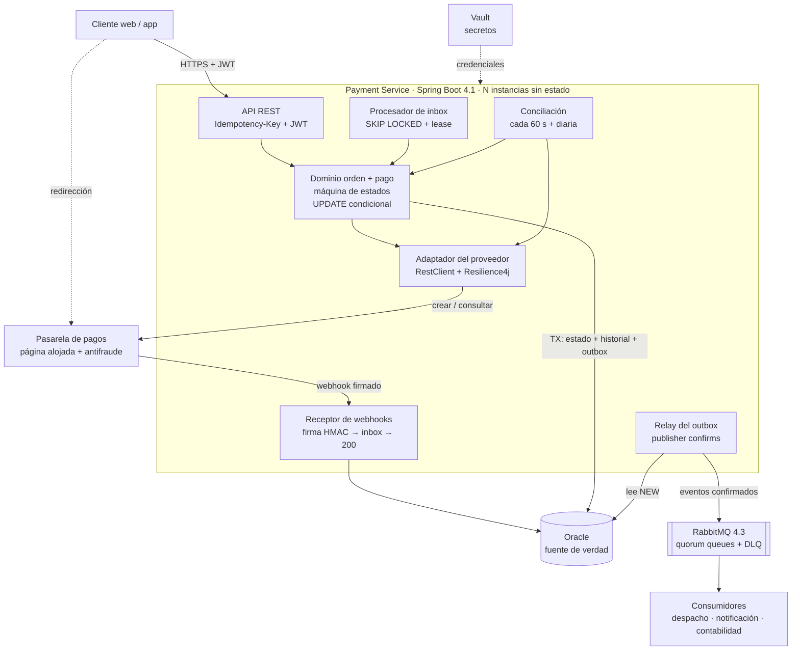
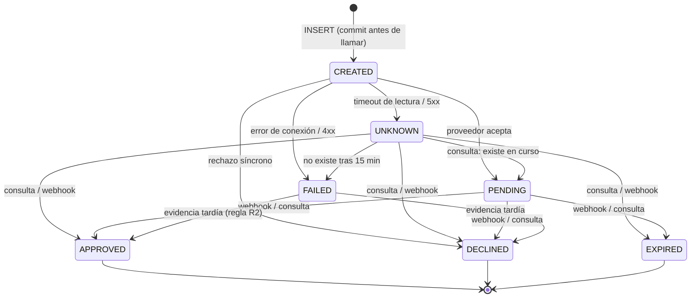
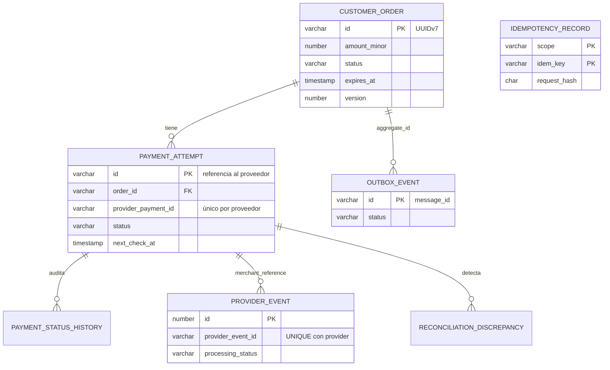
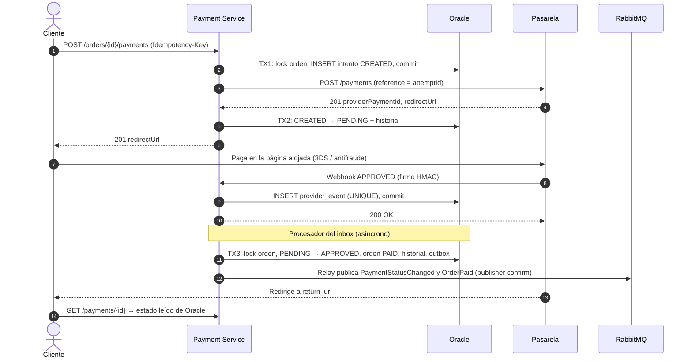
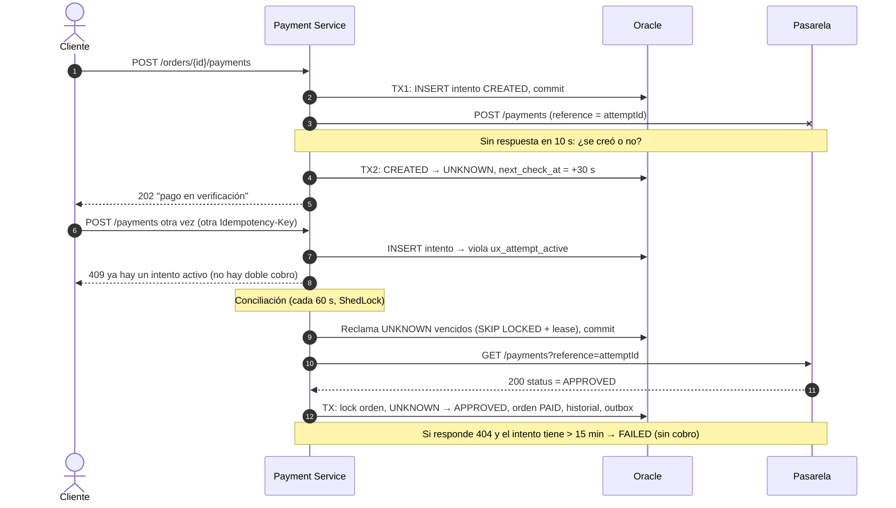
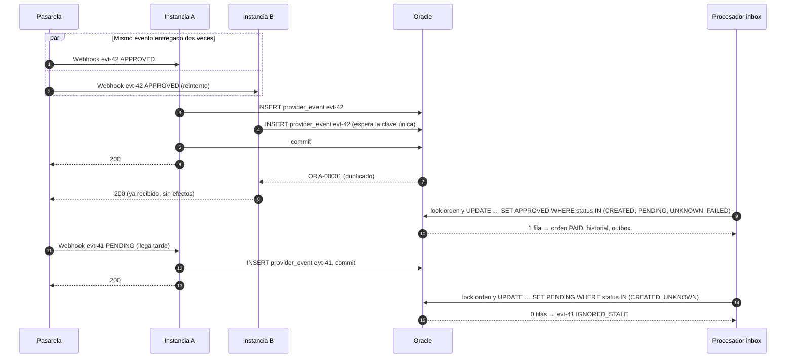

# Integración asíncrona con una pasarela de pagos — Diseño técnico

Proceso de selección · Desarrollador Java Senior · Noviembre de 2026

---

## 1. Resumen ejecutivo

La propuesta es un **Payment Service** en Java 25 LTS y Spring Boot 4.1. Modela cada intento de pago como una máquina de estados persistida en Oracle. Obtiene el resultado por dos vías independientes, webhook y consulta activa, y **ante la duda nunca crea un segundo cobro**.

El sistema entrega mensajes *al menos una vez* y aplica sus efectos de forma idempotente. El resultado neto es que cada efecto de negocio ocurre **exactamente una vez**.

| Riesgo del enunciado | Garantía | Mecanismo |
| --- | --- | --- |
| Cobro duplicado | Un reintento técnico nunca crea un segundo cobro | El id del intento viaja al proveedor como referencia única. Un índice único permite un solo intento activo por orden. |
| Notificación repetida | Sus efectos se aplican una sola vez | `UNIQUE (provider, provider_event_id)` en el inbox y transición condicional en la misma transacción |
| Notificación fuera de orden | Un estado nunca retrocede | Cada transición declara sus estados de origen válidos. Un evento viejo actualiza 0 filas y queda registrado como obsoleto. |
| Notificación perdida | El resultado se obtiene igual | Conciliación periódica por consulta y conciliación diaria contra la liquidación |
| Resultado incierto (timeout) | Nunca se interpreta como rechazo | Estado `UNKNOWN` hasta que el proveedor confirme. Mientras tanto, el cliente no puede abrir otro intento. |
| Orden en estado incorrecto | La orden cambia en la misma transacción que el pago | Bloqueo de la fila de la orden y actualización condicional de ambos |
| Evento interno perdido | Ningún hecho confirmado deja de publicarse | Transactional Outbox en la misma transacción que el cambio de estado |
| Falta de trazabilidad | Cada transición es reconstruible | Historial de solo inserción con origen, evento del proveedor y `correlation_id` |

---

## 2. Supuestos y reglas de negocio abiertas

### 2.1 Supuestos sobre el proveedor y el entorno

| Id | Supuesto | Si no se cumple |
| --- | --- | --- |
| S1 | El pago se completa en una página alojada por el proveedor (redirección). Ningún dato de tarjeta pasa por nuestro sistema. | Habría que tokenizar en el cliente y ampliar el alcance PCI DSS. |
| S2 | El proveedor acepta una referencia única del comercio y permite consultar el pago por ella. | Un timeout al crear solo se resuelve con el webhook o la liquidación diaria. |
| S3 | Si el proveedor admite una clave de idempotencia, se envía el mismo id del intento. | El diseño no depende de esto: sin ella, nunca se reintenta una creación con resultado incierto. |
| S4 | Los webhooks llegan firmados (HMAC-SHA256) y traen un id de evento único. | Sin id de evento, la clave es el SHA-256 de `(provider_payment_id, estado)`: repetir el mismo estado no tiene efecto adicional. |
| S5 | El proveedor reintenta los webhooks ante una respuesta distinta de 2xx durante al menos 24 h. | La conciliación cubre la entrega, con más latencia. |
| S6 | El proveedor entrega un archivo o API de liquidación diaria. | La conciliación se limita a consultas individuales. |
| S7 | El antifraude lo ejecuta el proveedor; nuestro sistema refleja su resultado. | Un antifraude propio sería un paso previo a iniciar el pago. |
| S8 | Montos en COP, guardados como enteros en la unidad mínima. Una moneda por orden. | Varias monedas exigen tasa de cambio y redondeo explícitos. |
| S9 | Al menos dos instancias sin estado detrás de un balanceador. La alta disponibilidad de Oracle (Data Guard o RAC) la gestiona infraestructura. | Con una sola instancia el diseño funciona igual, sin tolerancia a la caída de un nodo. |
| S10 | Dimensionamiento de referencia, a validar: picos de 50 pagos/s y 150 webhooks/s. | Se recalibran los timeouts, pools y umbrales de la sección 9. |

### 2.2 Reglas de negocio no especificadas

| Id | Pregunta | Decisión propuesta | Impacto si el negocio decide distinto |
| --- | --- | --- | --- |
| R1 | ¿Varios intentos simultáneos por orden? | No. Máximo un intento activo (`CREATED`, `PENDING`, `UNKNOWN`). Tras un rechazo o expiración se permite uno nuevo. | Permitirlo elimina el índice de intento activo y exige reembolsar automáticamente los cobros sobrantes. |
| R2 | ¿Pago aprobado sobre una orden ya pagada, expirada o cancelada? | El cobro es real y se registra. Una orden expirada o cancelada pasa a `REQUIRES_REVIEW`. Una orden pagada se mantiene `PAID`. En ambos casos se emite `RefundRequired` y una alerta. | Si el negocio prefiere entregar, la orden expirada pasa a `PAID`. |
| R3 | ¿Cuánto dura una orden sin pagar? | 30 min. No expira mientras tenga un intento activo. | Cambia un parámetro del job de expiración. |
| R4 | ¿Pagos parciales o montos distintos? | No. Un monto o moneda distintos son una discrepancia y la orden pasa a `REQUIRES_REVIEW`. | Exige un saldo pagado por orden y varios intentos aprobados. |
| R5 | ¿Cuánto esperar un resultado incierto? | Consultas con backoff durante 48 h y luego revisión manual. Nunca se marca rechazado sin evidencia. | Cambia el límite de la conciliación. |
| R6 | ¿Se puede cancelar una orden con pago en curso? | No, mientras exista un intento activo. | Exige cancelar el pago en el proveedor, si lo admite. |
| R7 | ¿Reembolsos y contracargos? | Fuera de alcance. Se emite `RefundRequired` como punto de extensión. | Requiere un subdominio de reembolsos. |

---

## 3. Stack tecnológico

Cada pieza se eligió por una propiedad que el problema necesita. Versiones validadas el 20-11-2026.

| Capa | Elección | Por qué |
| --- | --- | --- |
| Lenguaje | Java 25 LTS (el código compila también con 21) | Virtual threads para muchas llamadas de I/O concurrentes con código imperativo. Desde JDK 24 ([JEP 491](https://openjdk.org/jeps/491)) un virtual thread ya no fija su hilo de plataforma dentro de `synchronized`, que era el problema con drivers JDBC en Java 21. |
| Framework | Spring Boot 4.1.3 | Último parche de la línea estable, con soporte OSS hasta julio de 2027. La 4.0 pierde soporte el 31-12-2026. La 4.2.0 salió el 19-11-2026; se evaluará tras sus primeros parches. Usa las APIs de Jakarta EE (Servlet, Bean Validation). |
| Estilo | Monolito modular con arquitectura hexagonal | Orden y pago comparten una transacción ACID. Los microservicios exigirían sagas sin aportar nada a este alcance. Los puertos aíslan al proveedor. |
| Base de datos | Oracle (DDL compatible con 19c) | Fuente de verdad. Índices únicos sobre expresiones (equivalen a índices parciales), `FOR UPDATE SKIP LOCKED`, particionamiento por intervalo. 19c tiene soporte Premier hasta 2029. |
| Persistencia | Spring `JdbcClient` con SQL explícito | Las transiciones dependen de `UPDATE … WHERE status IN (…)`, `FOR UPDATE SKIP LOCKED` e índices sobre expresiones. Con SQL explícito la garantía de concurrencia es visible y comprobable, sin depender de lo que genere un ORM. JPA sería válido para lecturas o pantallas de soporte. |
| PL/SQL | Paquete de conciliación diaria | Comparación por conjuntos sobre volumen alto, donde están los datos. La lógica transaccional queda en Java. |
| Migraciones | Flyway | DDL versionado, el mismo en pruebas y producción. |
| Mensajería | RabbitMQ 4.3, quorum queues | Difunde hechos confirmados a otros sistemas. La 4.3 trae reintentos con retardo nativos en quorum queues y DLQ. |
| Consistencia BD ↔ broker | Transactional Outbox con relay propio | Evita la escritura doble y el two-phase commit, sin infraestructura adicional. |
| Cliente del proveedor | `RestClient` (HTTP/1.1) y Resilience4j 2.4 (módulos core, configuración programática) | Un solo mecanismo para timeouts, circuit breaker, bulkhead y reintentos selectivos, con métricas en Micrometer. La configuración en código deja explícito qué se reintenta y qué no. `@Retryable` de Spring 7 no trae circuit breaker. |
| Jobs | `@Scheduled` y ShedLock | Un solo nodo ejecuta cada corrida. |
| Seguridad | Spring Security (OAuth2 Resource Server) y HashiCorp Vault | JWT para la API; firma propia en el webhook; secretos rotables fuera del código. |
| Observabilidad | Logs JSON estructurados, Micrometer, OpenTelemetry (OTLP), Prometheus y Grafana | Formato y exportadores nativos de Boot 4. |
| Pruebas | JUnit 5, AssertJ, Testcontainers (Oracle Free), WireMock, Awaitility | Integración contra Oracle real; WireMock simula los fallos del proveedor. Propuestas para la siguiente fase: Testcontainers RabbitMQ, ArchUnit y Gatling (sección 12). |

**Descartados:**
- **Redis:** una segunda fuente de verdad puede desincronizarse; la clave única en la misma transacción es más fuerte.
- **Kafka:** no hace falta reprocesar un log ni ese throughput.
- **WebFlux:** los virtual threads dan la misma escalabilidad con código más legible.
- **Debezium:** más infraestructura de la que este volumen necesita.
- **Microservicios:** romperían la atomicidad entre orden y pago.

**Portabilidad a Jakarta EE:**
- Spring MVC ↔ JAX-RS
- `@Transactional` ↔ JTA
- RabbitMQ ↔ JMS
- JPA es la misma

---

## 4. Arquitectura

Todo cambio de estado se confirma primero en Oracle. RabbitMQ solo difunde hechos ya confirmados.



### 4.1 Responsabilidades

| Componente | Responsabilidad | No hace |
| --- | --- | --- |
| API REST | Crea órdenes, inicia intentos de pago y expone su estado. Exige `Idempotency-Key` en cada POST y JWT en todas las llamadas. | No llama al proveedor dentro de una transacción abierta. |
| Dominio (orden y pago) | Contiene las máquinas de estado y aplica cada transición con `UPDATE` condicional. En la misma transacción escribe el historial y el outbox. | No conoce HTTP ni el formato del proveedor. |
| Adaptador del proveedor | Implementa `PaymentProviderPort` (crear, consultar). Traduce estados; aplica timeouts, circuit breaker y bulkhead. | No escribe en la base de datos. |
| Receptor de webhooks | Verifica la firma y la frescura. Guarda en el inbox y responde 200. | No aplica efectos de negocio; así responde en milisegundos y no pierde eventos. |
| Procesador del inbox | Reclama eventos pendientes con `SKIP LOCKED` y los aplica al dominio con reintentos. | No decide por su cuenta: delega en la máquina de estados. |
| Conciliación | Cada 60 s consulta los intentos `CREATED` antiguos, `UNKNOWN` y `PENDING` vencidos. Una vez al día compara la liquidación con PL/SQL. | No resuelve un caso incierto sin evidencia. |
| Relay del outbox | Publica los eventos confirmados con confirmación del broker y los marca `SENT`. | No garantiza entrega única; los consumidores deduplican por `message_id`. |
| Oracle | Fuente de verdad. | — |
| RabbitMQ | Entrega eventos a otros sistemas, con reintentos y DLQ. | No es fuente de verdad. |
| Vault | Credenciales del proveedor, secretos HMAC (dos vigentes durante una rotación) y credenciales de BD. | — |

### 4.2 Decisiones clave

1. **Dos transacciones cortas alrededor de la llamada al proveedor.** La primera guarda el intento en `CREATED` y hace commit *antes* de llamar. Así:
    - un webhook que llegue antes que la respuesta ya encuentra el intento por su referencia;
    - una caída a mitad de camino deja rastro para la conciliación;
    - ninguna conexión ni bloqueo de BD queda retenido durante la llamada HTTP.
2. **El webhook es señal, no la única fuente.** Webhook y consulta activa pasan por la misma máquina de estados: el primero que llega gana y el segundo es un no-op.
3. **Un mismo patrón de trabajo distribuido.** El inbox, el outbox y la conciliación reclaman trabajo con `FOR UPDATE SKIP LOCKED` y un *lease* (`next_attempt_at`). Si una instancia muere, el lease vence y otra la retoma.
4. **Instancias sin estado:** todo el estado vive en Oracle, así que el escalado es horizontal.

### 4.3 Contrato de los eventos publicados

Cada evento viaja en un sobre con metadatos, inspirado en CloudEvents. El `eventId` es también el `message_id` AMQP y el id de la fila en `outbox_event`.

```json
{
  "eventId": "01a1fa9a-b9a0-7052-87e4-89bc83a47e80",
  "eventType": "PaymentStatusChanged",
  "schemaVersion": 1,
  "occurredAt": "2026-11-20T20:16:46.496Z",
  "source": "payment-service",
  "correlationId": "01a1fa9a-b973-79d7-9507-cef950d69536",
  "data": {
    "payment":    { "attemptId": "…", "orderId": "…", "provider": "DEMO", "providerPaymentId": "pay_1" },
    "amount":     { "valueMinor": 150000, "currency": "COP" },
    "transition": { "from": "PENDING", "to": "APPROVED" }
  }
}
```

| Campo | Para qué sirve |
| --- | --- |
| `eventId` | El consumidor descarta duplicados (entrega *at-least-once*). |
| `eventType` | También es la *routing key* del exchange *topic* `payments.events`. |
| `schemaVersion` | Un cambio incompatible publica la versión 2 sin romper a los consumidores actuales. |
| `occurredAt` | Permite al consumidor descartar un evento más viejo que el último que aplicó. |
| `correlationId` | Une el evento con la petición HTTP y los logs que lo originaron. |

Tipos: `PaymentStatusChanged`, `OrderPaid`, `RefundRequired` y `PaymentNeedsReview`. Los montos van siempre en unidades mínimas y como enteros.

---

## 5. Máquinas de estado

Un intento de pago solo avanza. Un timeout lo lleva a `UNKNOWN`, nunca a un nuevo cobro.



### 5.1 Intento de pago: transiciones permitidas

La tabla es la especificación que implementa `PaymentStateMachine`. Los orígenes de cada fila son exactamente la lista `status IN (…)` del `UPDATE` condicional.

| Destino | Orígenes permitidos | Lo provoca |
| --- | --- | --- |
| `PENDING` | `CREATED`, `UNKNOWN` | Creación aceptada, o una consulta que encuentra el pago en curso |
| `UNKNOWN` | `CREATED` | Timeout de lectura o 5xx al crear; intento `CREATED` huérfano de más de 2 min |
| `APPROVED` | `CREATED`, `PENDING`, `UNKNOWN`, `FAILED` | Webhook, consulta o liquidación |
| `DECLINED` | `CREATED`, `PENDING`, `UNKNOWN`, `FAILED` | Webhook, consulta o rechazo síncrono |
| `EXPIRED` | `CREATED`, `PENDING`, `UNKNOWN`, `FAILED` | El proveedor informa que el cliente no completó el pago |
| `FAILED` | `CREATED`, `UNKNOWN` | Error de conexión o 4xx al crear, o referencia no encontrada tras 15 min |

Hay dos clases de estado terminal:
- **Informados por el proveedor** (`APPROVED`, `DECLINED`, `EXPIRED`). Son definitivos. Un evento que los contradiga queda registrado y genera una alerta crítica.
- **Inferido por nosotros** (`FAILED`). Se basa en la ausencia de evidencia, así que la evidencia del proveedor puede corregirlo.

### 5.2 Orden

| Estado | Entra cuando | Sale a |
| --- | --- | --- |
| `AWAITING_PAYMENT` | Se crea la orden | `PAID`, `EXPIRED`, `CANCELLED`, `REQUIRES_REVIEW` |
| `PAID` | Un intento pasa a `APPROVED` con el monto y la moneda esperados | Terminal. Un segundo cobro aprobado emite `RefundRequired`. |
| `EXPIRED` | `expires_at` vencido y sin intento activo | `REQUIRES_REVIEW` si llega una aprobación tardía |
| `CANCELLED` | El cliente cancela sin intento activo | `REQUIRES_REVIEW` si llega una aprobación tardía |
| `REQUIRES_REVIEW` | Aprobación sobre una orden no pagable, o monto distinto | Resolución manual o reembolso (fuera de alcance) |

---

## 6. Modelo de datos

Siete tablas sostienen las garantías. Tres restricciones hacen el trabajo crítico:
- el índice único de intento activo;
- el `UNIQUE` del inbox;
- la PK de idempotencia.



| Tabla | Propósito | Restricciones e índices relevantes |
| --- | --- | --- |
| `customer_order` | Orden y su estado | `CHECK` de estado y monto > 0. Índice `(status, expires_at)` para la expiración. |
| `payment_attempt` | Cada intento de cobro. Su `id` es la referencia enviada al proveedor. | Único de intento activo por orden. Único de `provider_payment_id`. Índice `(status, next_check_at)` para conciliación. |
| `payment_status_history` | Auditoría de solo inserción | Particionada por mes. El usuario de la aplicación solo tiene `INSERT` y `SELECT`. |
| `provider_event` | Inbox de webhooks | `UNIQUE (provider, provider_event_id)`. Índice `(processing_status, next_attempt_at)`. |
| `outbox_event` | Eventos por publicar | Índice `(status, next_attempt_at)` |
| `idempotency_record` | `Idempotency-Key` → recurso creado | La PK impide procesar dos veces; `request_hash` detecta una clave reutilizada con otro cuerpo (422). |
| `reconciliation_discrepancy` | Diferencias halladas | Índice `(resolution, detected_at)` |

**Convenciones:**
- **Ids:** UUIDv7 generados en la aplicación. Se envían al proveedor sin una ida extra a la BD y, al ser ordenables por tiempo, no fragmentan el índice.
- **Fechas:** `TIMESTAMP` en UTC. Oracle no admite `TIMESTAMP WITH TIME ZONE` como clave de particionamiento por intervalo.
- **Montos:** `NUMBER(19)` en la unidad mínima de la moneda.

**Dos detalles propios de Oracle:**
- **Índice "parcial".** Oracle no tiene índices parciales, pero no indexa filas cuya clave es enteramente `NULL`. Un índice único sobre `CASE WHEN status IN (…) THEN order_id END` cubre solo los intentos activos.
- **`UNIQUE` con columnas nulas.** Un `UNIQUE (provider, provider_payment_id)` normal fallaría: Oracle considera duplicadas dos filas con el mismo `provider` y `provider_payment_id` nulo, y los intentos `CREATED` aún no tienen ese id. Por eso se usa una expresión que excluye las filas con id nulo.

El DDL completo está en el **Anexo A** (migraciones Flyway `V1__schema.sql` y `V2__settlement.sql`).

---

## 7. Secuencias

### 7.1 Flujo exitoso



La redirección de retorno puede llegar antes que el webhook. La página de retorno no confía en sus parámetros: muestra el estado guardado en Oracle y lo consulta periódicamente mientras siga `PENDING`.

### 7.2 Timeout al crear: UNKNOWN y conciliación



### 7.3 Webhook duplicado, concurrente y fuera de orden



---

## 8. Idempotencia y concurrencia

La idempotencia se aplica en cuatro capas. En todas, la garantía final la da una restricción de Oracle evaluada dentro de la transacción, no una comprobación previa en memoria.

| Capa | Clave | Dónde se persiste | Con dos ejecuciones concurrentes |
| --- | --- | --- | --- |
| API del cliente | `Idempotency-Key` + `scope` | `idempotency_record`, PK `(scope, idem_key)`, misma TX que crea el recurso | El segundo `INSERT` espera y recibe `ORA-00001`: se devuelve el mismo recurso (mismo id, estado actual). Si el cuerpo es distinto, 422. |
| Intento activo | `order_id` mientras el intento es `CREATED`/`PENDING`/`UNKNOWN` | Índice único `ux_attempt_active` | Solo un `INSERT` prospera; el otro recibe 409. Es la barrera contra el doble clic con claves distintas. |
| Hacia el proveedor | `payment_attempt.id` como referencia (y clave de idempotencia si se admite) | Columna `id`, con commit antes de la llamada | Un reintento usa la misma referencia. Un timeout de lectura nunca se reintenta a ciegas: pasa a `UNKNOWN`. |
| Webhooks | `(provider, provider_event_id)` | `provider_event`, `UNIQUE` | El segundo `INSERT` recibe `ORA-00001` y se responde 200 sin efectos. |

**Regla de concurrencia única:** toda transacción que modifica una orden o sus intentos **bloquea primero la fila de la orden** (`SELECT … FOR UPDATE`) y después actúa sobre el intento.

- **Serialización por orden.** Dos eventos del mismo pago se aplican uno tras otro, y el segundo ve el estado que dejó el primero. Entre órdenes distintas no hay contención.
- **Sin interbloqueos.** El orden de bloqueo es siempre orden → intento. El caso que lo motiva: un webhook aprueba un intento mientras el cliente abre otro. Sin esta regla, el índice de intento activo y la orden se bloquearían en orden inverso (`ORA-00060`).
- **El `UPDATE` condicional decide.** Si afecta 1 fila, se aplican los efectos. Si afecta 0, el evento era duplicado u obsoleto y se registra como `IGNORED_STALE`.
- **Nunca un bloqueo durante una llamada HTTP.** La conciliación reclama con un lease en una transacción corta, llama al proveedor sin transacción abierta y aplica el resultado en otra transacción.
- **Detalles de Oracle:**
    - Oracle no permite `FETCH FIRST` junto con `FOR UPDATE`: el lote se limita con `maxRows` del cursor.
    - Ante dos `UPDATE` sobre la misma fila, Oracle reevalúa el `WHERE` del segundo contra la versión confirmada (*write consistency*).

La implementación está en `PaymentTransitionService` del repositorio.

---

## 9. Resiliencia y recuperación

Solo se reintenta lo que es seguro reintentar. Lo demás se convierte en un estado explícito que resuelve la conciliación. Las cifras son valores iniciales y se calibran con el SLA del proveedor.

### 9.1 Timeouts y reintentos

| Operación | Timeout | Reintentos | Al agotarse |
| --- | --- | --- | --- |
| Crear pago (POST) | Conexión 2 s, respuesta 10 s | Solo ante un fallo de *conexión* (la petición no salió): 2 reintentos, 200/400 ms con jitter. Ante un timeout de *lectura* o 5xx: ninguno. | Conexión o 4xx: `FAILED`. Lectura o 5xx: `UNKNOWN` y respuesta 202. |
| Consultar estado (GET) | Conexión 2 s, respuesta 5 s | 2 reintentos (3 intentos en total), backoff exponencial desde 250 ms con jitter; leer es seguro | Se reprograma `next_check_at`. |
| Circuit breaker | Ventana de 100 llamadas; se abre con 50 % de fallos o 50 % de llamadas de más de 5 s | 30 s abierto y 10 llamadas de prueba | Los nuevos pagos reciben 503 sin crear intento; la conciliación se pausa. |
| Bulkhead | — | Máximo 100 llamadas concurrentes | Con virtual threads no hay pool que limite la concurrencia; este límite protege al proveedor. |
| Procesador del inbox | Lease de 60 s | 10 intentos, backoff de 1 s a 10 min | `FAILED`, alerta y reproceso manual: una DLQ dentro de la BD. |
| Relay del outbox | Confirmación del broker: 5 s | Ilimitados, backoff hasta 1 min. Se publica como `mandatory`: un mensaje sin cola de destino vuelve al relay y se reintenta. | Alerta si el pendiente más antiguo supera 2 min. Nada se descarta. |
| Consumidores RabbitMQ | — | `delivery-limit` 5 con reintento con retardo nativo | DLQ, alerta y reenvío manual. |
| Conciliación `UNKNOWN` | — | A los 30 s, luego 1, 2, 4… min (máx. 30 min entre consultas), durante 48 h | Alerta crítica y revisión manual (regla R5); nunca se resuelve sin evidencia. |
| Oracle | Sentencia 5 s; Hikari `connectionTimeout` 3 s | — | La API y el webhook responden 503; el proveedor reintenta. |

### 9.2 Conciliación

**Incremental, cada 60 s** (ShedLock):
1. Reclama con `SKIP LOCKED` y un lease los intentos:
    - `CREATED` con más de 2 min (caída entre la llamada y el guardado);
    - `UNKNOWN` con `next_check_at` vencido;
    - `PENDING` con más de 15 min (posible webhook perdido).
2. Consulta al proveedor por la referencia.
3. Aplica el resultado con la misma `transition(...)` que usa el webhook, con origen `RECONCILIATION`.
4. Si la referencia no existe y el intento tiene más de 15 min, lo marca `FAILED`.

**Diaria, contra la liquidación** (04:30 UTC, sobre el día anterior, un solo nodo con ShedLock):
1. El puerto `SettlementFilePort` obtiene el archivo del día. La implementación incluida lee `<PROVEEDOR>_<fecha>.csv` del buzón donde el proceso SFTP lo deja. Si el archivo no llegó, la corrida falla y alerta: conciliar contra un archivo vacío marcaría todo como no liquidado.
2. Java borra y recarga las líneas del día en `settlement_line`, en lote. Si una línea está repetida, se revierte la carga completa.
3. `pkg_settlement.compare(p_run_date, p_provider)` cruza por conjuntos con `payment_attempt` y registra en `reconciliation_discrepancy`:

| Tipo | Significa | Resolución |
| --- | --- | --- |
| `APPROVED_NOT_HERE` | Liquidado como aprobado y aquí no está `APPROVED` (o no existe) | **Automática** si la máquina de estados lo permite: `transition(...)` con origen `SETTLEMENT` y la discrepancia pasa a `AUTO_FIXED`. Si aquí está `DECLINED`/`EXPIRED` o el pago no existe: revisión manual. |
| `NOT_SETTLED` | `APPROVED` aquí ese día y sin línea aprobada en la liquidación | Revisión manual |
| `AMOUNT_MISMATCH` | Línea aprobada con monto o moneda distintos | Revisión manual |

La corrida es idempotente: un índice único sobre las discrepancias abiertas impide duplicarlas si el archivo se reenvía. Operaciones puede re-ejecutar un día con `POST /admin/settlement/run?date=…`, endpoint expuesto solo en la red interna.

### 9.3 Matriz de recuperación

| Escenario | Qué queda | Cómo se recupera |
| --- | --- | --- |
| Caída entre llamar al proveedor y guardar la respuesta | Intento `CREATED` | La conciliación lo toma a los 2 min y consulta por referencia. |
| Caída mientras se procesa un webhook | Evento `RECEIVED` con lease vencido | Otra instancia lo reprocesa; la transición es idempotente. |
| Caída tras publicar y antes de marcar `SENT` | Evento del outbox `NEW` | Se republica; los consumidores deduplican por `message_id`. |
| Proveedor caído o lento | Circuit breaker abierto | 503 rápido a los nuevos pagos; los pendientes se concilian al cerrar el circuito. |
| Webhook perdido | `PENDING` sin avance | Conciliación a los 15 min; como último recurso, la liquidación diaria. |
| Oracle no disponible | Nada se confirma | 503 y reintento del proveedor. No queda estado a medias. |
| RabbitMQ no disponible | El outbox acumula | El relay drena sin pérdida al volver el broker. |
| Mensaje sin cola de destino | El broker lo devuelve (`mandatory`) | El evento sigue `NEW` y se reintenta; alerta por `payments_outbox_unroutable`. |
| Mensaje que siempre falla | — | DLQ tras 5 entregas y reenvío manual. |
| Resultado incierto | `UNKNOWN`; el cliente no puede abrir otro intento | Conciliación hasta 48 h y luego revisión manual. |

---

## 10. Seguridad

- **Autenticidad e integridad del webhook:**
    - HMAC-SHA256 sobre `timestamp + "." + cuerpo crudo`, comparado en tiempo constante (`MessageDigest.isEqual`).
    - Se rechaza un timestamp con más de 5 min de desfase (anti-replay). El `UNIQUE` del inbox cubre la repetición dentro de esa ventana.
    - Se aceptan dos secretos vigentes durante una rotación.
    - Una firma inválida responde 401, no se persiste e incrementa una métrica.
    - Defensa en profundidad: lista de IPs del proveedor si la publica, tamaño máximo del cuerpo de 64 KB y rate limit.
- **Retorno del cliente:** los parámetros de la URL de retorno no se usan como fuente de estado; podrían manipularse.
- **Datos de tarjeta:** nunca pasan por el sistema (página alojada, S1). El alcance PCI DSS se reduce al cuestionario SAQ A.
- **Credenciales:** en Vault, nunca en el repositorio, en la configuración ni en los logs. Credenciales de BD dinámicas y usuario de aplicación sin privilegios de DDL.
- **Datos personales:**
    - El inbox guarda solo una lista blanca de campos del payload.
    - Los logs enmascaran correos y documentos.
    - Tráfico con TLS 1.2+; cifrado en reposo con Oracle TDE si la licencia lo permite.
    - Cumplimiento de la Ley 1581 de 2012 (protección de datos personales).
- **Integridad de la auditoría:** el historial solo admite `INSERT`. El usuario de aplicación no tiene `UPDATE` ni `DELETE` sobre esa tabla.
- **API:** OAuth2/JWT y validación de entrada con Bean Validation.

---

## 11. Observabilidad

**Logs JSON estructurados:**
- **Campos siempre presentes:** `trace_id`, `correlation_id`, `order_id`, `attempt_id`, `provider_payment_id`, `provider_event_id`, `from_status`, `to_status`, `source`.
- **Nunca se registran:** datos de tarjeta, secretos, cabeceras de firma ni payloads completos.
- **Correlación:** el `trace_id` (W3C `traceparent`) cubre cada petición. El webhook no trae nuestra traza, así que la unión entre trazas la hace `attempt_id`, que viaja como referencia de ida y vuelta.

| Métrica | Alerta |
| --- | --- |
| Intentos `UNKNOWN` y antigüedad del más viejo | > 15 min: aviso. > 2 h: crítica. |
| Antigüedad del evento del outbox más viejo sin enviar | > 2 min |
| Backlog del inbox y eventos `FAILED` | Backlog > 1.000 o > 5 min; cualquier `FAILED` |
| Profundidad de la DLQ | > 0 |
| Firmas de webhook inválidas | > 10 en 5 min (ataque o rotación mal hecha) |
| Latencia p99 y errores del proveedor; estado del circuit breaker | Circuito abierto > 1 min |
| Tasa de aprobación | Caída > 30 % frente a la misma hora de la semana anterior |
| Discrepancias de conciliación | > 0 |
| Eventos duplicados u obsoletos ignorados | Informativa |

**Reconstruir el ciclo de vida de una transacción:**

```sql
SELECT h.occurred_at, h.from_status, h.to_status, h.source,
       e.provider_event_id, e.event_type, h.correlation_id
  FROM payment_status_history h
  LEFT JOIN provider_event e ON e.id = h.provider_event_ref
 WHERE h.order_id = :orderId
 ORDER BY h.occurred_at;
```

---

## 12. Estrategia de pruebas

La columna **Estado** distingue lo que ya está automatizado en la implementación de referencia (✔) de lo que se propone para la siguiente fase.

| Nivel | Qué valida | Herramienta | Casos clave | Estado |
| --- | --- | --- | --- | --- |
| Unitarias | Máquina de estados | JUnit 5, AssertJ | Los 49 pares origen → destino de la tabla 5.1, permitidos o rechazados | ✔ `PaymentStateMachineTest` |
| Unitarias | Verificación de firma | JUnit 5 | Firma válida, cuerpo alterado, timestamp vencido o absurdo, segundo secreto en rotación | ✔ `WebhookSignatureVerifierTest` |
| Unitarias | Clave del inbox | JUnit 5 | Id del proveedor o hash de (pago, estado) cuando falta (supuesto S4) | ✔ `WebhookEventKeyTest` |
| Proveedor simulado | Políticas de resiliencia | WireMock | Éxito; timeout de lectura → `UNKNOWN` sin reintento; 5xx → `UNKNOWN`; conexión rechazada → `FAILED`; 4xx; 409; consulta con reintentos | ✔ `HttpPaymentProviderAdapterTest` |
| Integración | Flujo completo en Oracle real | Testcontainers (Oracle Free), Flyway | Webhook aprueba el pago y paga la orden una sola vez | ✔ `PaymentFlowIT` |
| Concurrencia | Exactamente un efecto | `CountDownLatch`, `ExecutorService` | Mismo webhook ×2 en paralelo → 1 historial y 1 evento. `PENDING` y `APPROVED` cruzados → final `APPROVED` | ✔ `PaymentFlowIT` |
| Fuera de orden | No hay retroceso | Integración | `APPROVED` y luego `PENDING` → sigue `APPROVED`; el evento queda `IGNORED_STALE` | ✔ `PaymentFlowIT` |
| Idempotencia API | Una sola llamada al proveedor | Integración + WireMock | Misma `Idempotency-Key` dos veces → mismo intento, 1 POST al proveedor | ✔ `PaymentFlowIT` |
| Recuperación | Resultado incierto | Integración, WireMock, Awaitility | Timeout → `UNKNOWN`, segundo intento bloqueado, la conciliación resuelve | ✔ `PaymentFlowIT` |
| Monto distinto | Regla R2 | Integración | Aprobado con otro monto → orden `REQUIRES_REVIEW` y discrepancia | ✔ `PaymentFlowIT` |
| Conciliación diaria | PL/SQL `pkg_settlement` | Integración | Los 3 tipos de discrepancia, corrección automática e idempotencia | ✔ `SettlementIT` |
| Mensajería | Outbox | Testcontainers (RabbitMQ) | Broker caído → el outbox acumula y luego drena; mensaje sin cola → no se marca `SENT` | Propuesta (verificado a mano con el entorno local) |
| Arquitectura | Límites hexagonales | ArchUnit | El dominio no depende de Spring Web ni de los adaptadores | Propuesta |
| Carga | Webhooks y API | Gatling | 150 webhooks/s con p99 < 200 ms | Propuesta |

**Total automatizado:** 84 pruebas (73 unitarias y 11 de integración), en verde con `./mvnw verify`.

---

## 13. Limitaciones y trabajo futuro

- **Reembolsos y contracargos:** fuera de alcance; solo se emite `RefundRequired`.
- **UX con resultado incierto:** mientras un intento está `UNKNOWN`, el cliente no puede pagar de nuevo, normalmente por segundos o minutos. Es una decisión deliberada para no cobrar dos veces.
- **Orden de los eventos en RabbitMQ:** no está garantizado por agregado. Los consumidores usan el estado, `occurredAt` y `schemaVersion` del sobre (sección 4.3), no el orden de llegada.
- **Usuario de base de datos:** en la implementación de referencia, Flyway migra con el mismo usuario de la aplicación. En producción las migraciones corren en el pipeline con un usuario dueño del esquema y la aplicación solo tiene DML.
- **Throughput del inbox:** cada instancia procesa su lote de forma secuencial. Si no alcanza el pico (S10), se paraleliza el lote con virtual threads; la transición idempotente lo permite.
- **Tamaño del webhook:** el límite de 64 KB se valida después de leer el cuerpo. En producción el gateway o el balanceador corta antes por `Content-Length`.
- **Carrera con el circuit breaker:** si el circuito se abre entre que se crea el intento y se llama al proveedor, el intento queda `FAILED` en vez de responder 503 sin crearlo. El cliente puede reintentar con un nuevo intento.
- **Un solo proveedor:** el puerto `PaymentProviderPort` permite añadir otros con enrutamiento.
- **Región única:** el RPO y el RTO dependen de la configuración de Oracle Data Guard.
- **Licencias:** el particionamiento por intervalo requiere la opción *Partitioning* de Oracle EE; sin ella, la purga se hace por lotes con PL/SQL.
- **Calibración:** las cifras de timeouts y umbrales son iniciales.

---

## 14. Herramientas utilizadas

- **Asistente de IA:** herramienta de apoyo para investigación, validación de versiones, redacción y código. El candidato revisó y validó todo el contenido, y asume y sustenta cada decisión en la defensa técnica.
- **Diagramas:** Mermaid.
- **Implementación de referencia:** Java 21+/Spring Boot 4.1.3 con el núcleo del diseño: máquina de estados, transición idempotente, inicio de pago con `UNKNOWN`, webhooks firmados, inbox, outbox con sobre versionado, conciliación incremental y conciliación diaria en PL/SQL con lector de archivo. Incluye 84 pruebas automatizadas (73 unitarias y 11 de integración contra Oracle real con Testcontainers).
- **Entorno local y demos:** Docker Compose con Oracle Free, RabbitMQ y una pasarela simulada (WireMock). Tres scripts reproducen los escenarios de este documento contra el servicio real: flujo completo con duplicados y eventos fuera de orden, timeout resuelto por conciliación, y conciliación diaria con los tres tipos de discrepancia. Una consola web recorre esos escenarios paso a paso con botones y muestra cada petición, el historial guardado en Oracle y los eventos publicados en RabbitMQ. El repositorio se puede probar en GitHub Codespaces sin instalar nada.

**Fuentes de versiones:**
- [Spring Boot: versiones y fechas de soporte](https://www.herodevs.com/blog-posts/spring-boot-versions-eol-dates-and-latest-releases-april-2026)
- [JEP 491](https://openjdk.org/jeps/491)
- [RabbitMQ 4.3](https://www.rabbitmq.com/blog/2026/04/23/rabbitmq-4.3-release)
- [Resilience4j](https://github.com/resilience4j/resilience4j/releases)
- [Spring Framework 7: funciones de resiliencia](https://docs.spring.io/spring-framework/reference/core/resilience.html)
- [Oracle AI Database 26ai](https://www.oracle.com/database/ai-native-database-26ai/)

---

## Anexo A. DDL (Oracle 19c+)

### A.1 Esquema principal (`V1__schema.sql`)

```sql
-- =====================================================================
-- Payment Service - esquema inicial (Oracle 19c+)
-- Convenciones: ids UUIDv7 generados en la aplicación, fechas TIMESTAMP en UTC,
-- montos NUMBER(19) en la unidad mínima de la moneda.
-- =====================================================================

-- Orden ---------------------------------------------------------------
CREATE TABLE customer_order (
  id            VARCHAR2(36)  PRIMARY KEY,
  customer_id   VARCHAR2(64)  NOT NULL,
  amount_minor  NUMBER(19)    NOT NULL CHECK (amount_minor > 0),
  currency      CHAR(3)       NOT NULL,
  status        VARCHAR2(20)  NOT NULL CHECK (status IN
                  ('AWAITING_PAYMENT','PAID','EXPIRED','CANCELLED','REQUIRES_REVIEW')),
  expires_at    TIMESTAMP     NOT NULL,
  version       NUMBER(10)    DEFAULT 0 NOT NULL,
  created_at    TIMESTAMP     DEFAULT SYS_EXTRACT_UTC(SYSTIMESTAMP) NOT NULL,
  updated_at    TIMESTAMP     DEFAULT SYS_EXTRACT_UTC(SYSTIMESTAMP) NOT NULL
);
CREATE INDEX ix_order_expiry   ON customer_order (status, expires_at);
CREATE INDEX ix_order_customer ON customer_order (customer_id, created_at);

-- Intento de pago -----------------------------------------------------
CREATE TABLE payment_attempt (
  id                  VARCHAR2(36)  PRIMARY KEY,      -- referencia enviada al proveedor
  order_id            VARCHAR2(36)  NOT NULL REFERENCES customer_order (id),
  attempt_no          NUMBER(3)     NOT NULL,
  provider            VARCHAR2(20)  NOT NULL,
  provider_payment_id VARCHAR2(64),
  amount_minor        NUMBER(19)    NOT NULL,
  currency            CHAR(3)       NOT NULL,
  status              VARCHAR2(20)  NOT NULL CHECK (status IN
                        ('CREATED','PENDING','UNKNOWN','APPROVED','DECLINED','EXPIRED','FAILED')),
  status_reason       VARCHAR2(100),
  redirect_url        VARCHAR2(1000),
  check_count         NUMBER(5)     DEFAULT 0 NOT NULL,
  next_check_at       TIMESTAMP,
  version             NUMBER(10)    DEFAULT 0 NOT NULL,
  created_at          TIMESTAMP     DEFAULT SYS_EXTRACT_UTC(SYSTIMESTAMP) NOT NULL,
  updated_at          TIMESTAMP     DEFAULT SYS_EXTRACT_UTC(SYSTIMESTAMP) NOT NULL,
  CONSTRAINT uq_attempt_no UNIQUE (order_id, attempt_no)   -- también indexa la FK
);
-- Como máximo un intento activo por orden (regla R1).
-- Oracle no indexa claves enteramente NULL: el índice solo contiene intentos activos.
CREATE UNIQUE INDEX ux_attempt_active ON payment_attempt (
  CASE WHEN status IN ('CREATED','PENDING','UNKNOWN') THEN order_id END);
-- Id del proveedor único, ignorando los intentos que aún no lo tienen.
-- Un UNIQUE (provider, provider_payment_id) normal trataría como duplicadas
-- dos filas con el mismo provider y provider_payment_id NULL.
CREATE UNIQUE INDEX ux_provider_payment ON payment_attempt (
  CASE WHEN provider_payment_id IS NOT NULL THEN provider END, provider_payment_id);
CREATE INDEX ix_attempt_recon ON payment_attempt (status, next_check_at);

-- Historial de transiciones (solo inserción) ---------------------------
-- En producción: PARTITION BY RANGE (occurred_at) INTERVAL (NUMTOYMINTERVAL(1,'MONTH'))
-- (requiere la opción Partitioning; se omite aquí para que corra en Oracle Free).
CREATE TABLE payment_status_history (
  id                 NUMBER GENERATED ALWAYS AS IDENTITY PRIMARY KEY,
  attempt_id         VARCHAR2(36)  NOT NULL REFERENCES payment_attempt (id),
  order_id           VARCHAR2(36)  NOT NULL,
  from_status        VARCHAR2(20),
  to_status          VARCHAR2(20)  NOT NULL,
  source             VARCHAR2(20)  NOT NULL CHECK (source IN
                       ('API','WEBHOOK','RECONCILIATION','SETTLEMENT','MANUAL')),
  provider_event_ref NUMBER,
  correlation_id     VARCHAR2(64)  NOT NULL,
  detail             VARCHAR2(400),
  occurred_at        TIMESTAMP     DEFAULT SYS_EXTRACT_UTC(SYSTIMESTAMP) NOT NULL
);
CREATE INDEX ix_history_attempt ON payment_status_history (attempt_id, occurred_at);
CREATE INDEX ix_history_order   ON payment_status_history (order_id, occurred_at);

-- Inbox de webhooks ---------------------------------------------------
CREATE TABLE provider_event (
  id                  NUMBER GENERATED ALWAYS AS IDENTITY PRIMARY KEY,
  provider            VARCHAR2(20)  NOT NULL,
  provider_event_id   VARCHAR2(100) NOT NULL,
  merchant_reference  VARCHAR2(36),
  provider_payment_id VARCHAR2(64),
  event_type          VARCHAR2(50)  NOT NULL,
  reported_status     VARCHAR2(20),
  reported_amount     NUMBER(19),
  reported_currency   CHAR(3),
  payload             CLOB          NOT NULL CHECK (payload IS JSON),
  processing_status   VARCHAR2(20)  DEFAULT 'RECEIVED' NOT NULL CHECK (processing_status IN
                        ('RECEIVED','PROCESSED','IGNORED_STALE','FAILED')),
  attempts            NUMBER(3)     DEFAULT 0 NOT NULL,
  next_attempt_at     TIMESTAMP     DEFAULT SYS_EXTRACT_UTC(SYSTIMESTAMP) NOT NULL,
  last_error          VARCHAR2(400),
  received_at         TIMESTAMP     DEFAULT SYS_EXTRACT_UTC(SYSTIMESTAMP) NOT NULL,
  processed_at        TIMESTAMP,
  CONSTRAINT uq_provider_event UNIQUE (provider, provider_event_id)
);
CREATE INDEX ix_event_pending ON provider_event (processing_status, next_attempt_at);

-- Outbox --------------------------------------------------------------
CREATE TABLE outbox_event (
  id              VARCHAR2(36)  PRIMARY KEY,           -- message_id en RabbitMQ
  aggregate_type  VARCHAR2(30)  NOT NULL,
  aggregate_id    VARCHAR2(36)  NOT NULL,
  event_type      VARCHAR2(50)  NOT NULL,
  payload         CLOB          NOT NULL CHECK (payload IS JSON),
  status          VARCHAR2(10)  DEFAULT 'NEW' NOT NULL CHECK (status IN ('NEW','SENT')),
  attempts        NUMBER(5)     DEFAULT 0 NOT NULL,
  next_attempt_at TIMESTAMP     DEFAULT SYS_EXTRACT_UTC(SYSTIMESTAMP) NOT NULL,
  created_at      TIMESTAMP     DEFAULT SYS_EXTRACT_UTC(SYSTIMESTAMP) NOT NULL,
  sent_at         TIMESTAMP
);
CREATE INDEX ix_outbox_pending ON outbox_event (status, next_attempt_at);

-- Idempotencia de la API ------------------------------------------------
CREATE TABLE idempotency_record (
  scope          VARCHAR2(100) NOT NULL,
  idem_key       VARCHAR2(100) NOT NULL,
  request_hash   CHAR(64)      NOT NULL,
  resource_id    VARCHAR2(36),
  response_code  NUMBER(3),
  response_body  CLOB,
  created_at     TIMESTAMP     DEFAULT SYS_EXTRACT_UTC(SYSTIMESTAMP) NOT NULL,
  expires_at     TIMESTAMP     NOT NULL,
  CONSTRAINT pk_idempotency PRIMARY KEY (scope, idem_key)
);

-- Discrepancias de conciliación ------------------------------------------
CREATE TABLE reconciliation_discrepancy (
  id                  NUMBER GENERATED ALWAYS AS IDENTITY PRIMARY KEY,
  run_type            VARCHAR2(20)  NOT NULL CHECK (run_type IN ('INCREMENTAL','SETTLEMENT')),
  attempt_id          VARCHAR2(36),
  provider_payment_id VARCHAR2(64),
  our_status          VARCHAR2(20),
  provider_status     VARCHAR2(20),
  our_amount          NUMBER(19),
  provider_amount     NUMBER(19),
  resolution          VARCHAR2(20)  DEFAULT 'OPEN' NOT NULL CHECK (resolution IN
                        ('OPEN','AUTO_FIXED','MANUAL_FIXED','ACCEPTED')),
  detected_at         TIMESTAMP     DEFAULT SYS_EXTRACT_UTC(SYSTIMESTAMP) NOT NULL,
  resolved_at         TIMESTAMP
);
CREATE INDEX ix_discrepancy_open ON reconciliation_discrepancy (resolution, detected_at);

-- ShedLock ------------------------------------------------------------
CREATE TABLE shedlock (
  name       VARCHAR2(64)  NOT NULL PRIMARY KEY,
  lock_until TIMESTAMP(3)  NOT NULL,
  locked_at  TIMESTAMP(3)  NOT NULL,
  locked_by  VARCHAR2(255) NOT NULL
);
```

### A.2 Conciliación diaria (`V2__settlement.sql`)

```sql
-- =====================================================================
-- Payment Service - conciliación diaria contra la liquidación (sección 9.2)
-- Compatible con Oracle 19c y Oracle Free 23.
--
-- Flyway (parser de Oracle) separa las sentencias SQL por ';' y los bloques
-- PL/SQL (CREATE PACKAGE / PACKAGE BODY, DECLARE / BEGIN) por una línea que
-- contiene solo '/'. Dentro de los bloques PL/SQL no debe haber ninguna línea
-- que empiece por '/'.
-- =====================================================================

-- Staging de la liquidación ----------------------------------------------
-- Java carga aquí el archivo del día (borra y recarga run_date + provider en
-- la misma transacción, así que recargar un archivo corregido es seguro).
CREATE TABLE settlement_line (
  run_date            DATE          NOT NULL,
  provider            VARCHAR2(20)  NOT NULL,
  provider_payment_id VARCHAR2(64)  NOT NULL,
  merchant_reference  VARCHAR2(36),                 -- nuestro attempt_id, si el proveedor lo devuelve
  status              VARCHAR2(20)  NOT NULL,       -- ya traducido a nuestro vocabulario (APPROVED, DECLINED...)
  amount_minor        NUMBER(19)    NOT NULL,
  currency            CHAR(3)       NOT NULL,
  loaded_at           TIMESTAMP     DEFAULT SYS_EXTRACT_UTC(SYSTIMESTAMP) NOT NULL,
  CONSTRAINT pk_settlement_line PRIMARY KEY (run_date, provider, provider_payment_id)
);
-- Búsqueda de "aprobado aquí y no liquidado" por nuestra referencia.
CREATE INDEX ix_settlement_reference ON settlement_line (run_date, provider, merchant_reference);

-- Intentos aprobados en un día (caso "aprobado aquí y no liquidado").
CREATE INDEX ix_attempt_status_updated ON payment_attempt (status, updated_at);

-- Discrepancias: tipo y datos de la liquidación ---------------------------
-- Columnas opcionales: las discrepancias INCREMENTAL existentes no las usan.
ALTER TABLE reconciliation_discrepancy ADD (
  discrepancy_type  VARCHAR2(30) CONSTRAINT ck_discrepancy_type CHECK (discrepancy_type IN
                      ('APPROVED_NOT_HERE','NOT_SETTLED','AMOUNT_MISMATCH')),
  settlement_date   DATE,
  provider          VARCHAR2(20),
  our_currency      CHAR(3),
  provider_currency CHAR(3)
);
ALTER TABLE reconciliation_discrepancy ADD CONSTRAINT ck_settlement_discrepancy CHECK (
  run_type <> 'SETTLEMENT'
  OR (discrepancy_type IS NOT NULL AND settlement_date IS NOT NULL AND provider IS NOT NULL));

-- Como máximo una discrepancia OPEN igual por (tipo, proveedor, día, pago).
-- El pago se identifica por el id del proveedor o, si no lo hay, por nuestro attempt_id.
-- Solo indexa discrepancias SETTLEMENT abiertas (Oracle no indexa claves enteramente NULL):
-- al resolverse salen del índice. Es la red de seguridad del NOT EXISTS de pkg_settlement.
CREATE UNIQUE INDEX ux_discrepancy_settlement_open ON reconciliation_discrepancy (
  CASE WHEN run_type = 'SETTLEMENT' AND resolution = 'OPEN' THEN discrepancy_type END,
  CASE WHEN run_type = 'SETTLEMENT' AND resolution = 'OPEN' THEN provider END,
  CASE WHEN run_type = 'SETTLEMENT' AND resolution = 'OPEN' THEN settlement_date END,
  CASE WHEN run_type = 'SETTLEMENT' AND resolution = 'OPEN' THEN NVL(provider_payment_id, attempt_id) END);

-- Cruce línea de liquidación -> intento --------------------------------------
-- Primero por nuestra referencia (PK del intento); si no viene o no existe, por el id
-- del proveedor. La condición sobre provider_payment_id replica la expresión del índice
-- UX_PROVIDER_PAYMENT para que el optimizador pueda usarlo.
CREATE OR REPLACE VIEW v_settlement_match AS
SELECT sl.run_date,
       sl.provider,
       sl.provider_payment_id,
       sl.merchant_reference,
       sl.status       AS provider_status,
       sl.amount_minor AS provider_amount,
       sl.currency     AS provider_currency,
       pa.id           AS attempt_id,
       pa.status       AS our_status,
       pa.amount_minor AS our_amount,
       pa.currency     AS our_currency
  FROM settlement_line sl
  LEFT JOIN payment_attempt by_ref
         ON by_ref.id = sl.merchant_reference
        AND by_ref.provider = sl.provider
  LEFT JOIN payment_attempt by_ppid
         ON CASE WHEN by_ppid.provider_payment_id IS NOT NULL THEN by_ppid.provider END = sl.provider
        AND by_ppid.provider_payment_id = sl.provider_payment_id
  LEFT JOIN payment_attempt pa
         ON pa.id = NVL(by_ref.id, by_ppid.id);

-- Paquete de comparación ------------------------------------------------------
CREATE OR REPLACE PACKAGE pkg_settlement AS
  -- Tipos de discrepancia (columna reconciliation_discrepancy.discrepancy_type).
  c_approved_not_here CONSTANT VARCHAR2(30) := 'APPROVED_NOT_HERE';
  c_not_settled       CONSTANT VARCHAR2(30) := 'NOT_SETTLED';
  c_amount_mismatch   CONSTANT VARCHAR2(30) := 'AMOUNT_MISMATCH';

  -- Cruza por conjuntos settlement_line (run_date, provider) contra payment_attempt e
  -- inserta en reconciliation_discrepancy (run_type = 'SETTLEMENT'):
  --   APPROVED_NOT_HERE: aprobado en la liquidación y no APPROVED aquí (o desconocido aquí);
  --   NOT_SETTLED:       APPROVED aquí ese día (updated_at) y sin línea APPROVED en la liquidación;
  --   AMOUNT_MISMATCH:   línea aprobada con monto o moneda distintos a los del intento.
  -- Idempotente: no inserta si ya hay una discrepancia OPEN igual. No hace COMMIT:
  -- la transacción la controla quien llama.
  PROCEDURE compare(p_run_date IN DATE, p_provider IN VARCHAR2);
END pkg_settlement;
/

CREATE OR REPLACE PACKAGE BODY pkg_settlement AS

  PROCEDURE compare(p_run_date IN DATE, p_provider IN VARCHAR2) IS
    v_day  DATE;
    v_from TIMESTAMP;
    v_to   TIMESTAMP;
  BEGIN
    IF p_run_date IS NULL OR p_provider IS NULL THEN
      RAISE_APPLICATION_ERROR(-20010, 'pkg_settlement.compare: p_run_date y p_provider son obligatorios');
    END IF;
    v_day  := TRUNC(p_run_date);
    v_from := CAST(v_day AS TIMESTAMP);       -- updated_at está en UTC
    v_to   := CAST(v_day + 1 AS TIMESTAMP);

    -- (a) Aprobado en la liquidación y no APPROVED aquí -----------------------
    INSERT INTO reconciliation_discrepancy
      (run_type, discrepancy_type, settlement_date, provider, attempt_id, provider_payment_id,
       our_status, provider_status, our_amount, provider_amount, our_currency, provider_currency)
    SELECT 'SETTLEMENT', c_approved_not_here, v_day, m.provider, m.attempt_id, m.provider_payment_id,
           m.our_status, m.provider_status, m.our_amount, m.provider_amount, m.our_currency, m.provider_currency
      FROM v_settlement_match m
     WHERE m.run_date = v_day
       AND m.provider = p_provider
       AND m.provider_status = 'APPROVED'
       AND (m.our_status IS NULL OR m.our_status <> 'APPROVED')
       AND NOT EXISTS (
             SELECT 1
               FROM reconciliation_discrepancy d
              WHERE d.run_type = 'SETTLEMENT'
                AND d.resolution = 'OPEN'
                AND d.discrepancy_type = c_approved_not_here
                AND d.provider = m.provider
                AND d.settlement_date = v_day
                AND NVL(d.provider_payment_id, d.attempt_id) = m.provider_payment_id);

    -- (b) APPROVED aquí ese día y sin línea APPROVED en la liquidación ---------
    -- provider_status queda NULL si el pago no aparece, o con el estado informado
    -- (p. ej. DECLINED) si aparece pero no aprobado.
    INSERT INTO reconciliation_discrepancy
      (run_type, discrepancy_type, settlement_date, provider, attempt_id, provider_payment_id,
       our_status, provider_status, our_amount, provider_amount, our_currency, provider_currency)
    SELECT 'SETTLEMENT', c_not_settled, v_day, pa.provider, pa.id, pa.provider_payment_id,
           pa.status,
           (SELECT MAX(sl.status)
              FROM settlement_line sl
             WHERE sl.run_date = v_day
               AND sl.provider = pa.provider
               AND (sl.merchant_reference = pa.id OR sl.provider_payment_id = pa.provider_payment_id)),
           pa.amount_minor, NULL, pa.currency, NULL
      FROM payment_attempt pa
     WHERE pa.status = 'APPROVED'
       AND pa.provider = p_provider
       AND pa.updated_at >= v_from
       AND pa.updated_at <  v_to
       AND NOT EXISTS (
             SELECT 1
               FROM settlement_line sl
              WHERE sl.run_date = v_day
                AND sl.provider = pa.provider
                AND sl.merchant_reference = pa.id
                AND sl.status = 'APPROVED')
       AND NOT EXISTS (
             SELECT 1
               FROM settlement_line sl
              WHERE sl.run_date = v_day
                AND sl.provider = pa.provider
                AND sl.provider_payment_id = pa.provider_payment_id
                AND sl.status = 'APPROVED')
       AND NOT EXISTS (
             SELECT 1
               FROM reconciliation_discrepancy d
              WHERE d.run_type = 'SETTLEMENT'
                AND d.resolution = 'OPEN'
                AND d.discrepancy_type = c_not_settled
                AND d.provider = pa.provider
                AND d.settlement_date = v_day
                AND NVL(d.provider_payment_id, d.attempt_id) = NVL(pa.provider_payment_id, pa.id));

    -- (c) Diferencia de monto o moneda en una línea aprobada -------------------
    INSERT INTO reconciliation_discrepancy
      (run_type, discrepancy_type, settlement_date, provider, attempt_id, provider_payment_id,
       our_status, provider_status, our_amount, provider_amount, our_currency, provider_currency)
    SELECT 'SETTLEMENT', c_amount_mismatch, v_day, m.provider, m.attempt_id, m.provider_payment_id,
           m.our_status, m.provider_status, m.our_amount, m.provider_amount, m.our_currency, m.provider_currency
      FROM v_settlement_match m
     WHERE m.run_date = v_day
       AND m.provider = p_provider
       AND m.provider_status = 'APPROVED'
       AND m.attempt_id IS NOT NULL
       AND (m.provider_amount <> m.our_amount OR m.provider_currency <> m.our_currency)
       AND NOT EXISTS (
             SELECT 1
               FROM reconciliation_discrepancy d
              WHERE d.run_type = 'SETTLEMENT'
                AND d.resolution = 'OPEN'
                AND d.discrepancy_type = c_amount_mismatch
                AND d.provider = m.provider
                AND d.settlement_date = v_day
                AND NVL(d.provider_payment_id, d.attempt_id) = m.provider_payment_id);
  END compare;

END pkg_settlement;
/

-- Oracle crea un paquete con errores de compilación como INVALID y solo devuelve un
-- aviso, que Flyway no trata como fallo. Se comprueba aquí para que la migración falle
-- en el despliegue y no en la primera llamada.
DECLARE
  v_errors VARCHAR2(4000);
BEGIN
  SELECT LISTAGG(type || ' ' || line || ':' || position || ' ' || SUBSTR(text, 1, 200), ' | ')
           WITHIN GROUP (ORDER BY type, sequence)
    INTO v_errors
    FROM user_errors
   WHERE name = 'PKG_SETTLEMENT'
     AND attribute = 'ERROR'
     AND ROWNUM <= 10;
  IF v_errors IS NOT NULL THEN
    RAISE_APPLICATION_ERROR(-20001, SUBSTR('pkg_settlement no compila: ' || v_errors, 1, 2000));
  END IF;
END;
/
```
